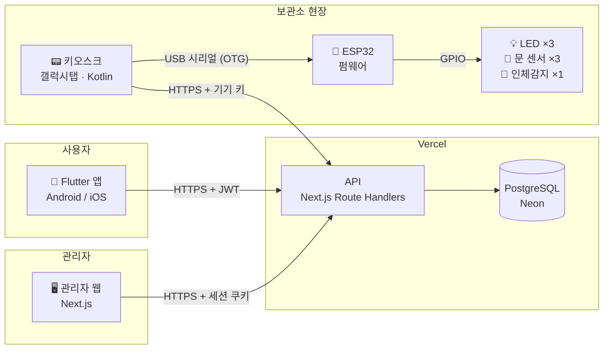

# 02. 시스템 구조 · 기술 스택 · 배포

## 전체 구조



**핵심 원칙**
- **서버가 유일한 진실**: 거래 상태·칸 상태는 서버 DB가 결정한다. 키오스크는 "QR 찍혔어요", "문 닫혔어요"를 보고만 하고, 판단은 서버가 한다.
- **ESP32는 단순하게**: 펌웨어는 "LED 켜/꺼/깜빡", "문 열림/닫힘 알림"만 한다. 업무 로직은 넣지 않는다.
- **키오스크는 서버와 ESP32의 다리**: 서버 응답을 받아 ESP32에 명령하고, ESP32 이벤트를 서버에 전달한다.

## 기술 스택

### web (관리자 웹 + API 서버)
| 항목 | 선택 | 이유 |
|---|---|---|
| 프레임워크 | Next.js (App Router) + TypeScript | 현업에서 쓰는 기술. 웹과 API를 한 프로젝트로 |
| API | Route Handlers (`app/api/**/route.ts`) | 별도 백엔드 없이 TypeScript 하나로 |
| ORM | Prisma | 스키마 → 마이그레이션 → 타입 자동 생성 |
| DB | PostgreSQL (Neon 무료 티어) | 관계형 DB 설계 경험 |
| 인증 | 관리자: httpOnly 세션 쿠키 / 앱: JWT / 키오스크: 기기 키 | 주체별 인증 방식 차이를 직접 구현 |
| 비밀번호 | bcrypt 해시 | |
| 검증 | zod | 요청 바디 검증 |
| UI | Tailwind CSS | |

### app (사용자 앱)
| 항목 | 선택 |
|---|---|
| 프레임워크 | Flutter (Android / iOS) |
| 상태관리 | Riverpod |
| 라우팅 | go_router |
| 통신 | dio |
| QR 표시 | qr_flutter |
| 토큰 저장 | flutter_secure_storage |

### kiosk (키오스크, 갤럭시탭)
| 항목 | 선택 | 메모 |
|---|---|---|
| 언어 / UI | Kotlin + Jetpack Compose | 처음 배우는 언어 |
| QR 스캔 | CameraX + ML Kit Barcode Scanning | 전면 카메라 사용 |
| 음성 안내 | Android TextToSpeech | 한국어 TTS |
| 서버 통신 | Retrofit + OkHttp + kotlinx.serialization | |
| USB 시리얼 | usb-serial-for-android | CP2102 드라이버 지원 |
| 구조 | MVVM (ViewModel + StateFlow) | |
| 최소 버전 | Android 13 (API 33) | |

### firmware (ESP32)
| 항목 | 선택 |
|---|---|
| 보드 | ESP32 DevKitC V4 (WROOM-32D, CP2102) |
| 프레임워크 | Arduino (C++) — 개발 도구는 PlatformIO 또는 Arduino IDE |
| 통신 | USB 시리얼 115200bps, 줄 단위 텍스트 프로토콜 ([06 문서](06-kiosk-hardware.md)) |

## 인증 설계

| 주체 | 방식 | 헤더 / 저장 위치 | 만료 |
|---|---|---|---|
| 사용자 (앱) | 이메일 + 비밀번호 → JWT 발급 | `Authorization: Bearer <jwt>` / secure storage | 7일 (확장 단계에서 refresh token 도입) |
| 관리자 (웹) | 이메일 + 비밀번호 → 세션 쿠키 | httpOnly, Secure, SameSite=Lax 쿠키 | 12시간 |
| 키오스크 | 관리자가 발급한 기기 키 | `X-Kiosk-Key: <key>` | 만료 없음, 관리자가 폐기 가능 |

- JWT와 세션에는 `userId`, `role`을 담고, API마다 허용 role을 검사한다.
- 앱 로그인 API는 `role=USER`만, 관리자 로그인 API는 `role=ADMIN`만 통과시킨다. → "사용자는 앱만, 관리자는 웹만"을 서버에서 강제
- 기기 키와 QR 토큰은 **DB에 해시로만 저장**한다 (원문은 발급 순간에만 보여줌).

## 서버 ↔ 키오스크 통신 방식
- MVP는 **키오스크가 요청하는 방식만** 사용한다 (QR 스캔, 문 이벤트 보고, 1분마다 하트비트).
- 서버 → 키오스크로 먼저 보내야 하는 기능(원격 열기 등)은 확장 단계에서 **폴링 → FCM** 순서로 도입한다.

## 배포 계획

| 대상 | 방법 | 비용 | 메모 |
|---|---|---|---|
| 관리자 웹 + API | Vercel (GitHub 연결 자동 배포) | 무료 | 도메인 구매는 선택 |
| DB | Neon PostgreSQL | 무료 티어 | |
| Android 앱 | Google Play Console | 등록비 $25 (1회) | **신규 개인 계정은 테스터 12명 이상, 14일 비공개 테스트 후 프로덕션 신청 가능** → 계정은 일찍 만들어 둔다 |
| iOS 앱 | App Store Connect | 연 $99 | TestFlight → 심사. 심사용 **데모 계정**을 제공하고, 키오스크 없이도 화면 흐름을 확인할 수 있게 안내 |
| 키오스크 | 서명된 APK를 GitHub Releases에 업로드 | 무료 | 확장 단계에서 앱 스스로 최신 버전 확인 → 설치 (Device Owner 시 무확인 설치) |
| 펌웨어 | 빌드 결과(.bin)를 GitHub Releases에 업로드 | 무료 | 확장 단계에서 OTA 검토 |

## 저장소 구조 (모노레포)

```
PickBox/
├── README.md
├── docs/        설계 문서
├── web/         Next.js (관리자 웹 + API)
├── app/         Flutter (사용자 앱)
├── kiosk/       Android Studio 프로젝트 (Kotlin)
└── firmware/    ESP32 펌웨어
```
