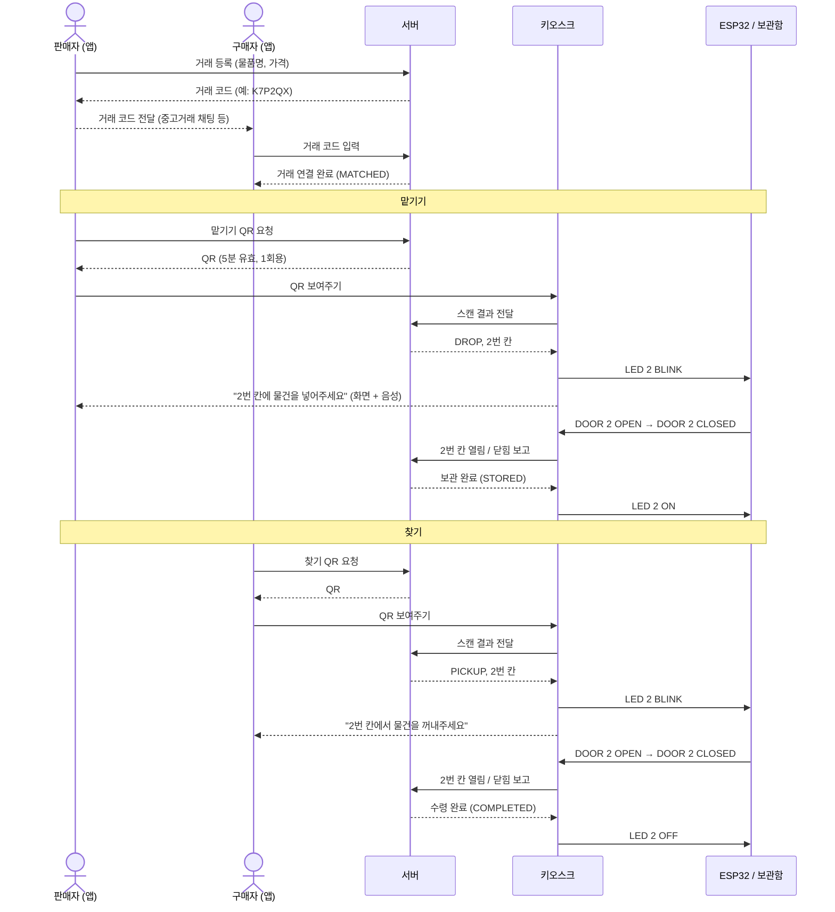
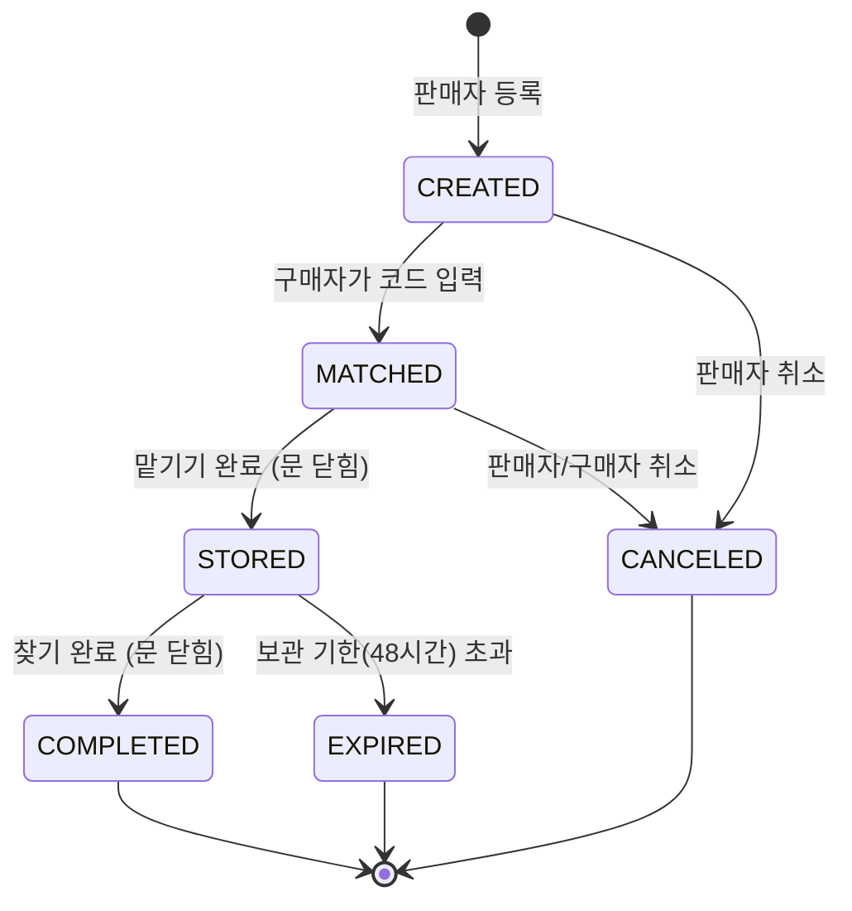
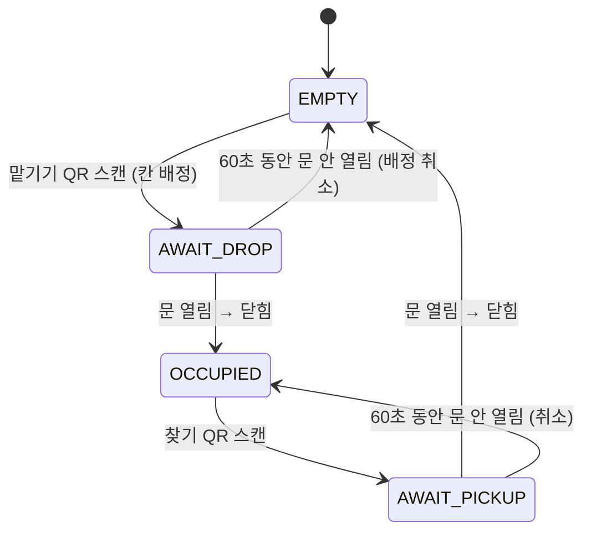
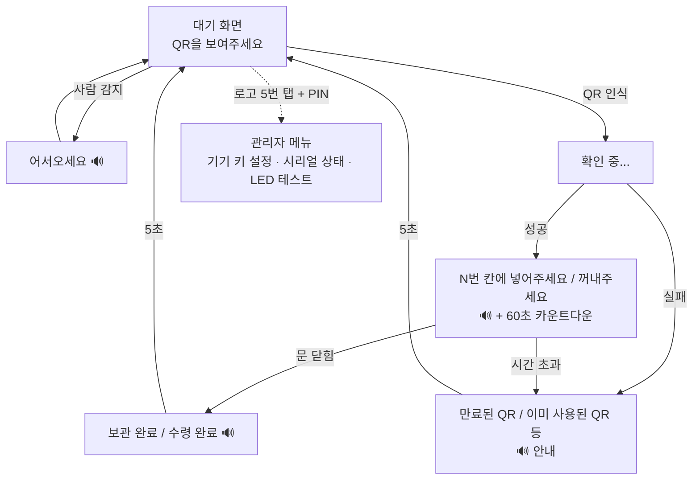

# 03. 사용자 흐름 · 상태 설계

## 1. 거래 전체 흐름

## 2. 거래(Trade) 상태

| 상태 | 의미 | 판매자 앱 | 구매자 앱 |
|---|---|---|---|
| CREATED | 등록됨, 구매자 없음 | 거래 코드 표시, 취소 | — |
| MATCHED | 구매자 연결됨 | **맡기기 QR**, 취소 | 보관 대기 중 |
| STORED | 보관함에 있음 | 보관 중 (칸 번호) | **찾기 QR** |
| COMPLETED | 수령 완료 | 완료 | 완료 |
| CANCELED | 취소됨 | | |
| EXPIRED | 기한 초과 | 관리자 문의 안내 | 관리자 문의 안내 |

**규칙**
- 맡기기는 구매자가 연결된(MATCHED) 거래만 가능하다 → 주인 없는 물건이 칸을 차지하지 않게
- STORED 이후에는 앱에서 취소할 수 없다 (물건이 보관함에 있으므로 관리자가 처리)
- 거래 코드는 6자리 영문 대문자+숫자, 헷갈리는 문자(0/O, 1/I) 제외

## 3. 보관함 칸(Locker) 상태

| 칸 상태 | LED | 의미 |
|---|---|---|
| EMPTY | 꺼짐 | 비어 있음 |
| AWAIT_DROP / AWAIT_PICKUP | **깜빡임** | 지금 열어야 할 칸 |
| OCCUPIED | 켜짐 | 물건 보관 중 |

**칸 배정 규칙**: EMPTY인 칸 중 번호가 가장 작은 칸. 빈 칸이 없으면 키오스크에 "현재 빈 보관함이 없습니다" 안내.

## 4. 문 이벤트 판단 (잠금장치가 없으므로 중요)

| 상황 | 서버 판단 | 결과 |
|---|---|---|
| AWAIT 상태 칸이 열렸다 닫힘 | 정상 | 거래·칸 상태 진행 |
| AWAIT 상태 칸이 열린 채 3분 이상 | 경고 | 키오스크 "문을 닫아주세요" 반복 안내, 관리자 웹 경고 |
| **EMPTY / OCCUPIED 칸이 열림** | **비정상 열림** | 이벤트 `UNEXPECTED_OPEN` 기록, 관리자 웹에 경고 표시, 키오스크 부저 |

→ 잠금장치는 없지만 "누가 언제 어떤 칸을 열었는지"는 전부 기록된다.

## 5. 키오스크 화면 흐름

## 6. 앱 화면 목록
| 화면 | 내용 |
|---|---|
| 로그인 / 회원가입 | 이메일, 비밀번호, 닉네임 |
| 홈 | 내 거래 목록 (탭: 판매 / 구매), 상태 뱃지 |
| 거래 등록 | 물품명, 가격, 메모 → 완료 시 거래 코드 표시 (복사·공유) |
| 거래 참여 | 거래 코드 입력 |
| 거래 상세 | 상태 타임라인, 칸 번호, **QR 보기** 버튼 (상태에 따라 맡기기/찾기) |
| QR 화면 | QR + 남은 시간 카운트다운, 만료 시 새로 발급 버튼, 화면 밝기 최대 |
| 내 정보 | 닉네임, 로그아웃, 탈퇴 |

## 7. 관리자 웹 화면 목록
| 화면 | 내용 |
|---|---|
| 로그인 | 관리자 계정 |
| 대시보드 | 칸 3개 상태 카드, 오늘 보관/수령 수, 키오스크 연결 상태(마지막 하트비트), 경고 |
| 거래 목록 | 상태 필터, 검색(거래 코드·물품명) |
| 거래 상세 | 판매자·구매자, 상태 타임라인(등록→연결→보관→수령 시각), 사용된 칸 |
| 이벤트 기록 | 문 열림/닫힘, 비정상 열림, 키오스크 접속 기록 |
