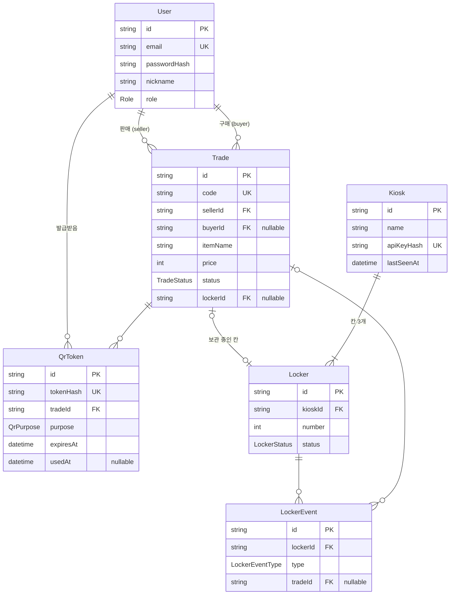

# 04. 데이터베이스

PostgreSQL + Prisma. 아래 스키마는 1단계에서 `web/prisma/schema.prisma`로 옮겨 시작한다.

## ERD



## Prisma 스키마 초안

```prisma
enum Role {
  USER
  ADMIN
}

enum TradeStatus {
  CREATED
  MATCHED
  STORED
  COMPLETED
  CANCELED
  EXPIRED
}

enum LockerStatus {
  EMPTY
  AWAIT_DROP
  OCCUPIED
  AWAIT_PICKUP
}

enum QrPurpose {
  DROP
  PICKUP
}

enum LockerEventType {
  ASSIGNED          // QR 스캔으로 칸 배정
  DOOR_OPEN
  DOOR_CLOSE
  STORED            // 보관 완료
  PICKED_UP         // 수령 완료
  ASSIGN_TIMEOUT    // 60초 안에 문을 안 열어 배정 취소
  UNEXPECTED_OPEN   // 배정 안 된 칸이 열림
  DOOR_LEFT_OPEN    // 3분 이상 열려 있음
}

model User {
  id           String    @id @default(cuid())
  email        String    @unique
  passwordHash String
  nickname     String
  role         Role      @default(USER)
  createdAt    DateTime  @default(now())

  sellingTrades Trade[]   @relation("Seller")
  buyingTrades  Trade[]   @relation("Buyer")
  qrTokens      QrToken[]
}

model Trade {
  id          String      @id @default(cuid())
  code        String      @unique            // 6자리 거래 코드
  sellerId    String
  buyerId     String?
  itemName    String
  price       Int
  memo        String?
  status      TradeStatus @default(CREATED)
  lockerId    String?     @unique            // 보관 중인 칸 (STORED일 때만)
  createdAt   DateTime    @default(now())
  matchedAt   DateTime?
  storedAt    DateTime?
  completedAt DateTime?
  canceledAt  DateTime?
  expiresAt   DateTime?                      // storedAt + 48시간

  seller   User          @relation("Seller", fields: [sellerId], references: [id])
  buyer    User?         @relation("Buyer", fields: [buyerId], references: [id])
  locker   Locker?       @relation(fields: [lockerId], references: [id])
  qrTokens QrToken[]
  events   LockerEvent[]

  @@index([sellerId])
  @@index([buyerId])
  @@index([status])
}

model Kiosk {
  id         String    @id @default(cuid())
  name       String                           // 예: "PickBox 1호점"
  location   String?
  apiKeyHash String    @unique
  lastSeenAt DateTime?
  createdAt  DateTime  @default(now())

  lockers Locker[]
}

model Locker {
  id            String       @id @default(cuid())
  kioskId       String
  number        Int                            // 1, 2, 3
  status        LockerStatus @default(EMPTY)
  pendingTradeId String?                       // AWAIT_* 상태일 때 대상 거래
  awaitUntil    DateTime?                      // AWAIT_* 만료 시각 (배정 + 60초)
  doorOpen      Boolean      @default(false)   // 마지막으로 보고된 문 상태
  updatedAt     DateTime     @updatedAt

  kiosk  Kiosk         @relation(fields: [kioskId], references: [id])
  trade  Trade?
  events LockerEvent[]

  @@unique([kioskId, number])
}

model QrToken {
  id        String    @id @default(cuid())
  tokenHash String    @unique                  // 원문은 앱에만, DB엔 SHA-256 해시
  tradeId   String
  userId    String
  purpose   QrPurpose
  expiresAt DateTime                           // 발급 + 5분
  usedAt    DateTime?
  createdAt DateTime  @default(now())

  trade Trade @relation(fields: [tradeId], references: [id])
  user  User  @relation(fields: [userId], references: [id])

  @@index([tradeId])
}

model LockerEvent {
  id        String          @id @default(cuid())
  lockerId  String
  tradeId   String?
  type      LockerEventType
  createdAt DateTime        @default(now())

  locker Locker @relation(fields: [lockerId], references: [id])
  trade  Trade? @relation(fields: [tradeId], references: [id])

  @@index([lockerId, createdAt])
}
```

## 설계 메모
- **ID는 cuid**: 순번 ID(1, 2, 3…)는 URL에 노출되면 거래 수를 추측할 수 있어서 사용하지 않는다.
- **토큰·키는 해시 저장**: DB가 유출돼도 QR 토큰이나 기기 키를 바로 쓸 수 없게.
- **상태 변경은 트랜잭션으로**: 예) 보관 완료 시 `Trade.status=STORED`, `Trade.lockerId`, `Locker.status=OCCUPIED`, `LockerEvent(STORED)`를 한 트랜잭션에서 처리. 동시에 두 사람이 같은 칸을 배정받지 않게 칸 배정도 트랜잭션 안에서.
- **시간은 UTC 저장**, 화면 표시는 KST.
- **초기 데이터(seed)**: 관리자 계정 1개, 키오스크 1대, 칸 3개(1~3번). 관리자 비밀번호와 기기 키는 seed 실행 시 환경변수에서 읽는다.
